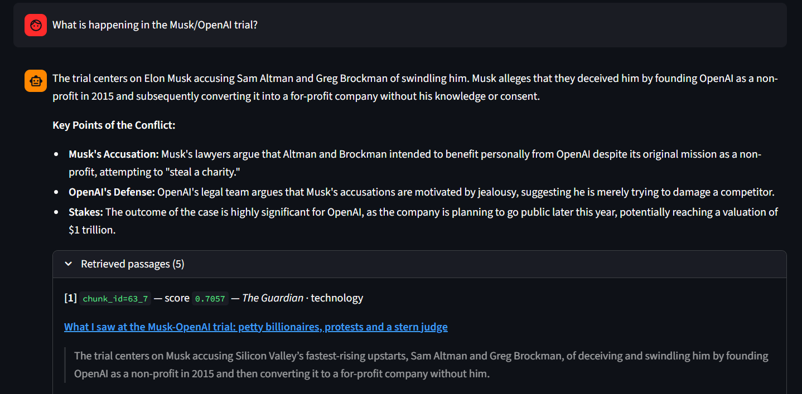
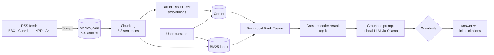

# News RAG Chatbot: Hybrid Retrieval-Augmented Generation

A chatbot that answers questions about **recent news** using only a corpus of ~500 articles scraped from BBC News, The Guardian, NPR and Ars Technica. Every answer is grounded in retrieved passages, cites its sources inline, and is checked by citation guardrails.

The project covers the full RAG lifecycle: **scraping → chunking → embeddings → vector store → retrieval → grounded generation → guardrails → automated faithfulness evaluation → iterative improvement.** Everything runs locally: Qdrant runs in Docker and the LLMs are served by Ollama.



---

## Results

Faithfulness (is every claim in the answer supported by the retrieved context?) measured with **DeepEval** on 5 hand-written gold questions, each answerable from exactly one article:

| Question | Baseline RAG | Hybrid RAG |
|---|:-:|:-:|
| Screen sizes of the new MacBook Pro M5 | 0.50 | **1.00** |
| % of Kansas wheat in poor condition (USDA) | 1.00 | 1.00 |
| Where the COP30 summit took place | 1.00 | 1.00 |
| Japan's biggest snack maker vs. ink shortages | 1.00 | 1.00 |
| New Nintendo Switch 2 price from September 1 | 0.00 | **0.67** |
| **Mean** | **0.70** | **0.93** |

**What made the difference**
- **Sentence chunks fragment facts.** The MacBook answer needed information spread across several sentences, and each sentence was a separate chunk. Two-to-three-sentence chunks keep related facts together.
- **Pure vector search retrieves boilerplate.** For *"How is climate change affecting global weather patterns?"* the baseline returned the same BBC newsletter sign-up line from 4 different articles (identical score 0.6229). Then the model correctly said it couldn't answer. BM25 plus a cross-encoder reranker push actual content to the top.
- **Grounding changes the behavior.** Without retrieval, the LLM gave long, generic answers from its training data. With RAG, it answered from the May 2026 articles with `chunk_id` citations, or said explicitly that the passages didn't contain the answer.

---

## How it works



### 1. Data collection
A Scrapy spider ([`news_spider.py`](news_spider.py)) seeds article discovery from 34 RSS feeds. It parses each site with its own CSS selectors, skips articles under 80 words, respects `robots.txt` and uses AutoThrottle. The resulting corpus has **500 articles and ~450k words**: 232 BBC, 145 Guardian, 89 NPR and 34 Ars Technica. It was scraped in May 2026.

### 2. Chunking and embeddings
| | Baseline (v1) | Improved (v2) |
|---|---|---|
| Chunk | 1 sentence | 2 sentences, extended to 3 if under 40 words |
| Chunks | 18,990 (avg 23 words) | 8,229 (avg 54 words) |
| Retrieval | Dense vector search | Dense + BM25 → RRF (k=60) → cross-encoder rerank |

Sentences under 8 words (bylines, captions) are dropped. Chunks are embedded with [`microsoft/harrier-oss-v1-0.6b`](https://huggingface.co/microsoft/harrier-oss-v1-0.6b) (1024-dim) and stored in Qdrant with their metadata (title, source, topic, URL). Each chunk has a citable `chunk_id` (`<article_id>_<index>`).

### 3. Hybrid retrieval (v2)
1. Get the top 20 candidates from **Qdrant** (semantic similarity).
2. Get the top 20 candidates from **BM25** (exact keyword match, which matters for names, numbers and product names).
3. Merge the two lists with **Reciprocal Rank Fusion**.
4. Rerank the fused candidates with the **`ms-marco-MiniLM-L-6-v2` cross-encoder** and keep the top k.

### 4. Grounded generation
The system prompt tells the model to answer **only** from the passages, to say *"The provided passages do not contain enough information"* when it can't, and to cite `[Passage ID, Source title]` inline. The LLM is configurable: any Ollama model works, and `gemma4` is the default.

### 5. Guardrails
Every answer is checked before it's shown:
1. **Citation presence**: it cites at least one retrieved `chunk_id`.
2. **Citation validity**: it doesn't cite a `chunk_id` that wasn't retrieved (no invented sources).
3. **Contradiction check**: it doesn't claim the information is missing *and* give a confident answer at the same time.

### 6. Evaluation
DeepEval's `FaithfulnessMetric` extracts the claims in each answer and checks them against the retrieved context. The judge is a local Ollama model, wrapped in a custom `DeepEvalBaseLLM`. All the experiments and their outputs are in [`news_rag_pipeline.ipynb`](news_rag_pipeline.ipynb).

---

## Project structure

```
├── news_spider.py            # Scrapy spider: RSS feeds → article pages → articles.jsonl
├── run_spider.py             # Runs the spider without a Scrapy project
├── rag_pipeline.py           # Chunking, retrieval (vector + hybrid), prompt, generation, guardrails
├── build_index.py            # Chunk + embed articles and load both Qdrant collections
├── streamlit_app.py          # Chat UI (pipeline toggle, model selection, article browser)
├── news_rag_pipeline.ipynb   # Full experiment: baseline → evaluation → improvement → re-evaluation
├── docker-compose.yml        # Qdrant
└── assets/                   # Screenshots
```

---

## Getting started

**Prerequisites:** Python 3.13, [Ollama](https://ollama.com), and Docker (or use the embedded Qdrant option below).

```bash
git clone https://github.com/alberto-avila/News-RAG-Chatbot.git
cd News-RAG-Chatbot
pip install -r requirements.txt

ollama pull gemma4            # or any other model, then pick it in the app sidebar
docker compose up -d          # Qdrant on localhost:6333

python run_spider.py          # scrape a fresh corpus into articles.jsonl
python build_index.py         # chunk, embed and load both collections (a GPU helps)
streamlit run streamlit_app.py
```

**No Docker?** Set `QDRANT_PATH=./qdrant_data` before running `build_index.py` and `streamlit run`. This uses Qdrant's embedded local mode, which stores data on disk.

> The scraped article text belongs to the publishers, so `articles.jsonl` isn't included in the repo. Running the spider builds a new corpus from that day's news, so the gold questions in the notebook only apply to the original May 2026 snapshot.

---

## Limitations and next steps

- **Small evaluation set.** 5 gold questions show the direction of the improvement, but a larger synthetic QA set (e.g. generated per article) would give a tighter estimate.
- **Self-judging.** The same local model generated the answers and judged faithfulness. An independent, stronger judge would reduce bias.
- **Heuristic guardrails.** The checks are string- and regex-based. An NLI-based check that each claim is entailed by the passages would be stronger.
- **Simple BM25 tokenization** (lowercase + whitespace split, no stemming or stopword removal).

---

*Built as part of my master's program at the University of Chicago.*
